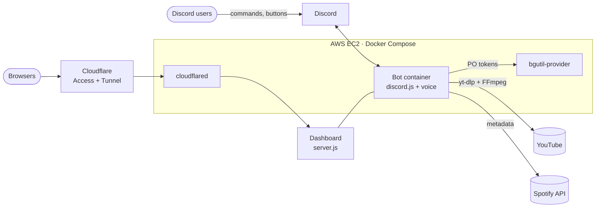

<div align="center">


# J4FN Music

**A Discord music bot that turns any voice channel into a live stage.**<br>
Play songs by name, YouTube or Spotify links, and run everything from one-tap buttons.

<a href="https://music.j4fn.site/invite"></a>
<a href="https://music.j4fn.site/status"></a>
<a href="https://github.com/MacroMaster101/discord_music_bot/actions/workflows/ci.yml"></a>
<a href="https://github.com/MacroMaster101/discord_music_bot/releases/latest"></a>

<a href="LICENSE"></a>

<br><br>

<a href="https://skillicons.dev"></a>

**[➕ Add to your server](https://music.j4fn.site/invite)** · **[📊 Live dashboard](https://music.j4fn.site)** · **[🟢 System status](https://music.j4fn.site/status)** · **[📰 Changelog](CHANGELOG.md)**

</div>

---

## ✨ Features

- 🎶 **Play anything by name.** Type a song name, or paste a YouTube link (videos, Shorts, live streams).
- 🟢 **Spotify links.** Paste a Spotify track, album, or playlist link and the bot plays it. Albums and playlists queue up to 100 songs.
- 📂 **Playlists.** Queue a whole YouTube playlist, Spotify album, or Spotify playlist at once.
- 🎛️ **One-tap controls.** Every song gets a Now Playing card with buttons: previous, skip, pause, seek ±10/30 seconds, loop, shuffle, volume, and queue.
- ⌨️ **Slash commands too.** Every `!` command also works as a `/` command, with options shown as you type.
- 🔍 **Search YouTube and Spotify.** `!search` shows results from both so you can pick the right version.
- 🎤 **Lyrics.** `!lyrics` finds the words to the current song.
- ⚡ **Quick starts.** The bot remembers which YouTube client worked last and tries it first.
- 🔄 **Keeps playing through updates.** After a restart, the bot rejoins and resumes the same song where it left off.
- 🔒 **Private per server.** Each server has its own queue, controls, and settings.
- 📊 **Live dashboard and status page.** See what's playing, which servers the bot is in, and uptime for Today, 7, 30, or 90 days.

---

## 🎮 Commands

Every command works two ways: type it with the `!` prefix (like `!play`), or as a **slash command** (type `/` and pick it, like `/play`). The bot owner can set a different `!` prefix for your server.

### Playing music
| Command | What it does |
| :--- | :--- |
| `!play <song or link>` (`!p`) | Play a song by name, or a YouTube or Spotify link. Adds to the queue if something is already playing. |
| `!search <song>` (`!sr`) | Show the top YouTube and Spotify results and pick one. |
| `!spotify <song>` (`!sp`) | Find a song on Spotify by name and play it. |
| `!playlist <link>` (`!pl`) | Queue a YouTube playlist, or a Spotify album or playlist. |
| `!pause` / `!resume` | Pause or resume. |
| `!skip` (`!s`) | Skip to the next song. |
| `!previous` (`!prev`, `!back`) | Go back to the song before this one. |
| `!seek <time>` | Jump to a time, like `1:30` or `90`. |
| `!nowplaying` (`!np`) | Show the current song with its control buttons. |
| `!lyrics` (`!ly`) | Show lyrics for the current song. |
| `!stop` (`!dc`) | Stop the music, clear the queue, and leave. |

### Managing the queue
| Command | What it does |
| :--- | :--- |
| `!queue` (`!q`) | See what's coming up. |
| `!shuffle` | Shuffle the upcoming songs. |
| `!remove <number>` | Remove a song from the queue. |
| `!move <from> <to>` (`!mv`) | Move a song to a different spot. |
| `!clear` | Clear the upcoming songs. |
| `!loop [off / song / queue]` (`!repeat`) | Repeat the current song or the whole queue. |
| `!volume <0-100>` (`!vol`) | Check or change the volume. |
| `!help` (`!h`) | Show all commands in Discord. |

When the bot is under maintenance, commands reply with a short notice instead, and the status page shows a banner.

---

## 🌐 Web dashboard

| Page | Who | What's there |
| :--- | :--- | :--- |
| [`/`](https://music.j4fn.site) | Everyone | Live rooms and joined servers (with search and *See more*), uptime, listener counts, commands, and a bug report form. |
| [`/status`](https://music.j4fn.site/status) | Everyone | Overall state, Today/7/30/90-day uptime bars for the bot, playback, Spotify, and the website, plus past incidents and maintenance. |
| `/admin` | Owner (Cloudflare Access or admin token) | Control every room, global and per-server settings, bot presence, maintenance mode, system health with incident and event logs, and the environment report. |

---

## 🧰 Tech stack

| Layer | Technology |
| :--- | :--- |
| Bot | [Node.js 22](https://nodejs.org) · [discord.js 14](https://discord.js.org) · [@discordjs/voice](https://github.com/discordjs/voice) (Opus over UDP) |
| Audio | [yt-dlp](https://github.com/yt-dlp/yt-dlp) (nightly) · [FFmpeg](https://ffmpeg.org) · [bgutil PO-token provider](https://github.com/Brainicism/bgutil-ytdlp-pot-provider) · [yt-search](https://github.com/talmobi/yt-search) |
| Integrations | Spotify Web API · Spotify embed reader · Formspree (bug reports) |
| Dashboard | Node.js `http` (no framework) · vanilla HTML, CSS, and JavaScript · strict CSP |
| Hosting | Docker Compose on AWS EC2 · Cloudflare Tunnel · Cloudflare Access (JWT verified) |
| Delivery | GitHub Actions (verify, deploy on `main`, branch sync) · Dependabot · CodeQL · GitGuardian |

<details>
<summary><strong>How the pieces fit</strong></summary>



</details>

---

## 🟢 About Spotify links

Spotify doesn't let bots stream its audio, so J4FN Music reads the song details from your Spotify link and plays the best-matching version from YouTube. It prefers official audio and avoids live or cover versions unless the song title asks for one. Once in a while the match may be a different recording of the same song.

Songs are also found by name on Spotify (`!spotify <song>`, or automatically when YouTube search finds nothing). The audio still comes from YouTube, so a song that exists only on Spotify can't be played. Private Spotify playlists can't be read; make a playlist public to play it.

---

## 🔒 Privacy

- Each server's queue, controls, and settings are separate. Other servers never see what you're playing in Discord.
- The [public dashboard](https://music.j4fn.site) shows server names, song titles, and overall stats, but never channels, members, queues, or settings. The [status page](https://music.j4fn.site/status) shows only component health.
- The bot asks only for the permissions it needs to join voice channels, play music, and post its messages.

---

## 🐞 Found a bug?

Use the 🐞 button on the [dashboard](https://music.j4fn.site), or [open an issue](../../issues). Report security problems privately; see [SECURITY.md](SECURITY.md).

---

## 🛠️ Run your own copy

```bash
git clone https://github.com/MacroMaster101/discord_music_bot.git
cd discord_music_bot
cp .env.example .env        # set TOKEN and ADMIN_TOKEN at minimum
docker compose up -d --build
```

The dashboard is then on `http://localhost:8080`. The [self-hosting guide](SELF_HOSTING.md) covers every setting, Cloudflare Tunnel and Access, automatic EC2 deploys, health checks, maintenance mode, and YouTube reliability.

## 🤝 Contributing

Work happens on feature branches that open pull requests into `dev`; `dev` is released to `main`, and every push to `main` deploys. See [CONTRIBUTING.md](CONTRIBUTING.md) for the branch rules and checks, and the [Code of Conduct](CODE_OF_CONDUCT.md).

---

## 📄 License

MIT. See [LICENSE](LICENSE).
